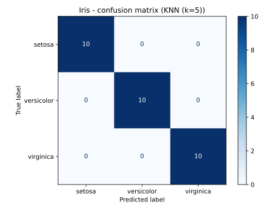

# Iris Flower Classification

Practice project built with AI assistance on a public dataset. It trains three
simple classifiers (KNN, SVM, Decision Tree) on the classic Iris dataset
and compares their accuracy on a held-out test split.

## Dataset

The classic Iris dataset: 150 flowers from 3 species (setosa, versicolor,
virginica), each described by 4 measurements (sepal/petal length and width).
The CSV is included in this repo. It is one of the most common teaching
datasets in machine learning, so high accuracy is expected.

## How to run

```bash
pip install -r requirements.txt
python iris_classification.py
```

The script prints the test accuracy of each model and saves a confusion
matrix for the best one to `results.svg`.

## Results (test split = 20%, random_state=42)

| Model              | Test accuracy |
|--------------------|---------------|
| KNN (k=5)          | 1.000         |
| SVM (RBF kernel)   | 0.967         |
| Decision Tree      | 0.967         |



## Honest notes

- This is a learning exercise on a small, clean, well-separated dataset,
  not a real-world application.
- The perfect KNN score comes from the dataset being easy to separate,
  not from any special tuning.
